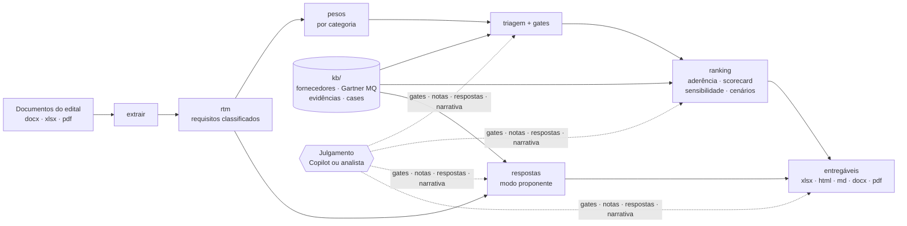

# Kit de análise de RFP de observabilidade

Metodologia e ferramenta para **avaliar** ou **responder** editais de observabilidade (RFP, RFQ, TR) com o mesmo
rigor em qualquer cliente: da leitura dos documentos do edital ao pacote de entregáveis, com evidência oficial
rastreável em cada fato, nota e resposta.

**Sumário:** [O que é](#o-que-é) · [Para que serve](#para-que-serve) · [A quem se destina](#a-quem-se-destina) ·
[Princípios](#princípios) · [Requisitos](#requisitos) · [Instalação](#instalação) · [Como usar](#como-usar) ·
[Entregáveis](#entregáveis) · [Como funciona](#como-funciona) · [Campo avaliado](#campo-avaliado) ·
[Referência](#referência) · [Base de conhecimento](#base-de-conhecimento-kb) ·
[Estrutura do repositório](#estrutura-do-repositório) · [Perguntas frequentes](#perguntas-frequentes) ·
[Limitações](#limitações-conhecidas) · [Contribuindo](#contribuindo)

---

## O que é

Um kit reutilizável — código Python, base de conhecimento de fornecedores, prompts e uma skill do GitHub Copilot —
que transforma os documentos de um edital de observabilidade (docx, xlsx, pdf) em:

- **matriz de requisitos** extraída e classificada numa taxonomia fixa;
- **triagem dos critérios eliminatórios (gates)** de cada fornecedor, com os fatos e as fontes usados;
- **ranking de mérito** (aderência ponderada pelo edital + scorecard de risco, esforço, custo e estratégia), com
  análise de sensibilidade e recomendação por cenário;
- no modo proponente, a **resposta item a item na planilha oficial do edital**, com justificativa e evidências;
- **relatórios, memorial técnico, sumário executivo, anexo de dúvidas e análises internas**.

O kit é executado **sempre no VS Code, pela skill do GitHub Copilot**. O código faz o trabalho determinístico
(extração, cálculos, preenchimento de planilhas, documentos e validações); o LLM faz, **a cada execução**, o que
depende de pesquisa e leitura:

1. **atualiza a base de conhecimento** dos fornecedores do campo (fatos, notas, evidências) e confere o Gartner MQ,
   em fontes oficiais;
2. **revisa todos os requisitos** do edital — entendimento, classificação, parâmetros e clareza;
3. **investiga cada requisito para cada fornecedor** da avaliação completa, com evidência oficial e citação literal;
4. **submete uma amostra a uma verificação independente** (outro modelo, sem ver a primeira conclusão);
5. **transforma toda lacuna em pergunta de esclarecimento** ao cliente — ou em pergunta ao fabricante/POC.

A **confiança** de cada avaliação é calculada pelo kit, por regras: só é **alta** quando o requisito é claro, a
citação oficial foi conferida literalmente na página nesta execução, o recurso é GA e a fonte cobre o parâmetro
pedido. Abaixo disso, o item precisa de encaminhamento — e a aderência passa a ser calculada item a item.

O kit confere essas etapas: se alguma não aconteceu na execução, a validação acusa erro e os entregáveis saem
marcados como **PRELIMINAR**. O julgamento (leitura das cláusulas, notas de contexto, respostas, narrativa) fica em
arquivos de análise simples (YAML e Markdown), sempre revisáveis.

O repositório **não contém dados de cliente**: cada análise acontece na pasta do próprio cliente.

## Para que serve

| Situação | Modo | Resultado |
|---|---|---|
| Um cliente pede apoio para **escolher** a plataforma de observabilidade, ou você quer entender o campo competitivo de um edital antes de decidir participar | `neutro` — estudo de seleção vendor-neutro | triagem de gates, ranking, sensibilidade, cenários, recomendação, relatórios e comparativo |
| Você vai **responder** o edital como fornecedor (por exemplo, com Azure Monitor) | `proponente` | planilha oficial respondida com evidências, anexo de dúvidas preenchido, memorial técnico e sumário executivo, além da inteligência competitiva interna |

Na prática, o kit ajuda a:

- **aplicar o mesmo método em todo edital:** gate antes do mérito, régua única de notas e pesos derivados do próprio
  edital;
- **ganhar tempo:** extração, classificação, cálculos, planilhas e documentos saem em minutos; o esforço humano fica
  no julgamento;
- **provar o que se afirma:** todo fato, nota e resposta aponta para uma fonte oficial com data, as URLs são
  verificadas e cada estudo guarda os seus dossiês de evidências;
- **entregar com qualidade:** a validação automática aponta erros antes da entrega (ajuste sem fonte, número
  digitado na narrativa, evidência vencida, resposta fora da escala, planilha do cliente alterada fora das células
  respondidas…);
- **ler o edital com olho crítico:** gates que só um fornecedor atende, direcionamento, armadilhas e dúvidas a enviar;
- **reaproveitar conhecimento:** a base de fornecedores, Gartner, evidências e cases melhora a cada edital, sem
  carregar dados de cliente.

## A quem se destina

- **Pré-vendas e arquitetos de soluções** (fabricantes e parceiros) que avaliam ou respondem RFPs de observabilidade,
  APM e monitoramento.
- **Consultores** que apoiam clientes na seleção de ferramenta de forma vendor-neutra.
- **Times de propostas e licitações** que precisam de um pacote de submissão consistente e rastreável.
- **Gestores e decisores**, como leitores dos entregáveis (sumário executivo, relatório executivo, comparativo).

Não é preciso programar: o uso é por conversa com o GitHub Copilot no VS Code, e ajustar a análise é editar arquivos
YAML/Markdown.

## Princípios

1. **Gate antes do mérito** — critério eliminatório é pass/fail; nenhuma nota compensa um gate reprovado.
2. **Azure Monitor sempre avaliado**, ao lado dos **Líderes da edição vigente do Gartner Magic Quadrant for
   Observability Platforms** e dos fornecedores de contexto do cliente.
3. **Só evidência pública oficial**, com URL e data. Sem fonte, sem nota. Preview não conta como GA.
4. **Honestidade nas respostas** — "Não atende" quando não atende; nada de marketing.
5. **Números vêm do cálculo** — a narrativa usa placeholders, nunca números digitados.
6. **Confiança antes de afirmar** — o que o edital e a documentação oficial não sustentam com confiança alta vira
   pergunta de esclarecimento (ou item de POC), nunca suposição; "atende plenamente" só com confiança alta.
7. **Nenhum dado de cliente no repositório** — confirmações obtidas num edital ficam no estudo daquele cliente.

## Requisitos

**Obrigatórios**

- **VS Code com GitHub Copilot** (Copilot Chat em modo agente, com suporte a skills) — é onde o kit é executado.
- **Acesso à internet** — para atualizar a KB, pesquisar evidências e verificar as URLs a cada execução.
- Python **3.10 ou superior** (testado com 3.12) e `pip`.
- Pacotes de [`requirements.txt`](requirements.txt): python-docx, openpyxl, Pillow, PyYAML, Jinja2, markdown e pypdf.
- Windows, macOS ou Linux.

**Opcionais, por recurso**

| Recurso | Precisa de |
|---|---|
| Memorial e sumário em **PDF** | Microsoft Word + `pip install pywin32` (Windows) **ou** LibreOffice (`soffice` no PATH) |
| **OCR** de PDF escaneado | `pip install pymupdf pytesseract` + Tesseract instalado (`TESSERACT_CMD` aponta o executável; `TESSDATA_PREFIX`, os idiomas) |
| Rodar os testes | `pip install -r requirements-dev.txt` (pytest) |
| Compartilhar/publicar | git e, se quiser, GitHub CLI (`gh`) |

## Instalação

```powershell
git clone <url-do-repositorio> kit-rfp-observabilidade
cd kit-rfp-observabilidade
python -m pip install -r requirements.txt
python kit.py kb-validar          # confere a base de conhecimento: deve terminar com 0 erro(s)
```

Para usar a skill fora deste repositório (por exemplo, abrindo no VS Code a pasta do cliente):

```powershell
.\scripts\instalar-skill.ps1       # copia a skill para ~/.copilot/skills e define RFP_KIT_HOME
```

No macOS/Linux: `bash scripts/instalar-skill.sh`.

## Como usar

### 1. Experimente com os exemplos fictícios (sem LLM)

```powershell
python exemplos/cliente-exemplo/gerar_exemplo.py                     # gera os documentos fictícios dos dois exemplos
python kit.py tudo exemplos/cliente-exemplo                           # estudo de seleção (modo neutro)
python kit.py tudo exemplos/cliente-exemplo-proponente --urls --pdf   # resposta como proponente (pacote completo)
```

Os exemplos rodam em modo de demonstração (`execucao.assistida: false`), sem as etapas de LLM. Comece pelo índice
`exemplos/cliente-exemplo/_analise-rfp/03-entregas/README-ENTREGAS.md` e pelo
`relatorio-exemplo.html`. No exemplo proponente, abra a planilha `Matriz-Requisitos-Exemplo - RESPONDIDA Azure
Monitor.xlsx`, o memorial técnico e o anexo de dúvidas preenchido.

### 2. Analisando o edital de um cliente — no VS Code

1. Coloque os documentos do edital numa pasta do cliente (fora deste repositório) e prepare a estrutura:
   ```powershell
   python kit.py init "C:\clientes\NovoCliente" --cliente "Novo Cliente S.A." --sigla NOVO
   # para responder como fornecedor, acrescente:  --modo proponente --proponente azure-monitor
   ```
   O `init` cria `_analise-rfp/`, o `rfp.yaml` e o workspace `NOVO-analise-rfp.code-workspace` (pasta do cliente +
   kit).
2. Abra esse workspace no VS Code e, no chat do Copilot (modo agente), invoque a skill:
   `/analise-rfp-observabilidade "C:\clientes\NovoCliente"` — ou peça em linguagem natural: *"Analise a RFP de
   observabilidade desta pasta"*, *"Responda a matriz desta RFP como Azure Monitor"*.
3. A skill ([`SKILL.md`](.github/skills/analise-rfp-observabilidade/SKILL.md)) conduz a **execução assistida**:

| Etapa | Quem faz | O que acontece |
|---|---|---|
| Extrair e configurar | kit + LLM | texto fiel dos documentos; gates transcritos das cláusulas — **você confirma** |
| Atualizar a KB | LLM (um subagente por fornecedor, em paralelo) | fatos, notas e evidências dos fornecedores do campo pesquisados em fontes oficiais; Gartner conferido |
| Revisar os requisitos | LLM (um subagente por lote) | todos os requisitos lidos e classificados; parâmetros e lacunas registrados; lacunas viram perguntas de esclarecimento |
| Investigar requisito × fornecedor | LLM (um subagente por fornecedor e lote) | atendimento, evidência oficial com citação literal, cobertura do parâmetro, lacuna tipificada e encaminhamento |
| Verificação independente | LLM de outro modelo | amostra reavaliada às cegas; divergências vão para **a sua decisão** |
| Calcular e verificar | kit | RTM, pesos, gates, aderência por item, ranking, sensibilidade, cenários; URLs e citações literais verificadas; confiança de cada avaliação |
| Decidir e escrever | você + LLM | triagem e ranking para **a sua decisão**; respostas (proponente), narrativa, dúvidas |
| Entregar | kit | planilhas, relatórios, documentos, dossiês e o índice `03-entregas/README-ENTREGAS.md` |

A validação (`02-analise/validacao.md`) só fica sem erro quando a execução assistida está completa: KB dos
fornecedores do campo e Gartner revisados na execução, 100% dos requisitos revisados, 100% das avaliações
requisito × fornecedor investigadas, a amostra da verificação independente conferida e sem divergência em aberto, toda
lacuna com pergunta e as URLs e citações verificadas. O **portão de confiança** acusa ainda: eliminatório abaixo de
confiança alta sem encaminhamento e resposta plena do proponente sem confiança alta. O resumo fica em `02-analise/execucao.json`. Ao final, versione no repositório do kit as
atualizações da KB (`kb/`) — nunca os arquivos do cliente.

### 3. Comandos que a skill usa (referência e diagnóstico)

A skill chama estes comandos; você também pode rodá-los no terminal do VS Code para diagnóstico. Fora do VS Code as
etapas de LLM não acontecem, e os entregáveis saem PRELIMINAR.

Os dados do cliente ficam **na pasta do cliente**, nunca no repositório do kit.

1. **Preparar** — cria `_analise-rfp/` e o `rfp.yaml`, detectando os documentos da pasta:
   ```powershell
   python kit.py init "C:\clientes\NovoCliente" --cliente "Novo Cliente S.A." --sigla NOVO
   # para responder como fornecedor, acrescente:  --modo proponente --proponente azure-monitor
   ```
2. **Extrair** o texto fiel dos documentos para `01-extracao/` (a qualidade da extração fica em `extracao-qa.json`):
   ```powershell
   python kit.py extrair "C:\clientes\NovoCliente"
   ```
3. **Configurar** o `rfp.yaml`: contexto do cliente, **gates** com a cláusula literal
   ([prompt 02](prompts/02-extrair-gates.md)) e, se a detecção automática não bastar, as colunas das planilhas.
4. **Atualizar a KB** (LLM): `python kit.py rtm` e `python kit.py ranking` mostram o campo avaliado
   (`02-analise/selecao.json`); os subagentes atualizam `kb/fornecedores/<id>.yaml` e `kb/evidencias/` e o Gartner
   ([kb-pesquisar-fornecedor](prompts/kb-pesquisar-fornecedor.md), [kb-atualizar-gartner](prompts/kb-atualizar-gartner.md));
   depois `python kit.py kb-validar` e `python kit.py kb-validar-urls --fornecedor <id> --atualizar`.
5. **Revisar, investigar e verificar com o LLM** e **rodar** o pipeline (`investigar` e `verificar-independente` seguem o
   mesmo padrão de lotes e `--consolidar` que `revisar`):
   ```powershell
   python kit.py revisar "C:\clientes\NovoCliente"               # lotes para os subagentes (prompt 14)
   python kit.py revisar "C:\clientes\NovoCliente" --consolidar  # incorpora os lotes e cria as dúvidas
   python kit.py tudo "C:\clientes\NovoCliente"
   ```
6. **Tratar as pendências** de `02-analise/validacao.md` — classificação ([01](prompts/01-classificar-pendencias.md)),
   fatos da KB, ajustes de nota ([03](prompts/03-ajustar-notas.md)) e eixos do scorecard
   ([04](prompts/04-eixos-scorecard.md)) — e rodar de novo.
7. **Decidir e escrever** — revisar triagem, ranking, sensibilidade e cenários (`02-analise/ranking.md` e
   `eliminatorios.md`), escrever `02-analise/narrativa.md` ([07](prompts/07-narrativa.md)) e registrar em
   `02-analise/registro-evidencias.yaml` as alegações que sustentam a decisão.
8. **Fechar** — rodar até **0 ERRO** e conferir o índice `03-entregas/README-ENTREGAS.md`:
   ```powershell
   python kit.py tudo "C:\clientes\NovoCliente" --pdf
   ```
   Para a versão enviada ao cliente, use `relatorio.incluir_pendencias: false` no `rfp.yaml`.

**No modo proponente**, além dos passos acima:

- `python kit.py respostas <pasta>` cria `02-analise/respostas.json` com cada requisito e a escala de resposta de
  cada aba (lida do dropdown da própria planilha). Preencha com o [prompt 09](prompts/09-respostas-matriz.md),
  citando evidências `EV-…` da KB, e rode de novo para gravar a planilha **RESPONDIDA**;
- dúvidas ao cliente em `02-analise/duvidas.yaml` ([05](prompts/05-armadilhas-duvidas.md)) →
  `python kit.py duvidas <pasta>`;
- pente-fino, roteiro de defesa, cases e esforço/custo conforme os módulos ativados (tabela abaixo).

**Módulos opcionais** — ativados em `modulos` no `rfp.yaml`; o kit cria o modelo do arquivo e o prompt orienta o
preenchimento:

| Módulo | Prompt | Arquivo em `02-analise/` |
|---|---|---|
| `armadilhas`, `direcionamento` | [05](prompts/05-armadilhas-duvidas.md) | `armadilhas-duvidas.md`, `direcionamento.md` (+ `duvidas.yaml`) |
| `red_team` | [06](prompts/06-red-team.md) | `red-team.md` |
| `poc` | [08](prompts/08-plano-poc.md) | `plano-poc.md` |
| `respostas` (proponente) | [09](prompts/09-respostas-matriz.md) | `respostas.json` |
| `pente_fino` | [10](prompts/10-pente-fino-evidencias.md) | `pente-fino-evidencias.md` |
| `defesa` | [11](prompts/11-roteiro-defesa-parciais.md) | `roteiro-defesa-parciais.md` |
| `cases` | [12](prompts/12-cases-referencia.md) | `cases-referencia.yaml` |
| `esforco`, `custo` | [13](prompts/13-esforco-custo.md) | `esforco-poc.yaml`, `custo.yaml` |

Sempre presentes (não são módulos): revisão de todos os requisitos ([14](prompts/14-revisar-requisitos.md)),
investigação requisito × fornecedor ([15](prompts/15-investigar-requisitos.md)), verificação independente
([16](prompts/16-verificacao-independente.md)) e
atualização da KB ([kb-pesquisar-fornecedor](prompts/kb-pesquisar-fornecedor.md),
[kb-evidencias-fornecedor](prompts/kb-evidencias-fornecedor.md), [kb-atualizar-gartner](prompts/kb-atualizar-gartner.md)).

## Entregáveis

Tudo é gerado dentro de `<pasta-do-cliente>/_analise-rfp/`. O índice `03-entregas/README-ENTREGAS.md` lista, a cada
execução, o status da execução assistida, o que vai para o cliente, o que é de uso interno e as pendências. Se a
execução assistida não se completou, relatórios e documentos Word saem com a marca **PRELIMINAR**.

### Peças finais (`03-entregas/`)

| Entregável | Conteúdo | Modo | Vai para o cliente? |
|---|---|---|---|
| `Sumario-Executivo-<sigla>.docx/.pdf` | mensagem principal, quadro-resumo, destaques, ressalvas e próximos passos | ambos | sim |
| `<planilha do edital> - RESPONDIDA <proponente>.xlsx` | planilha oficial respondida na escala de cada aba, com observação (justificativa, método, POC e referências); dropdowns, imagens e macros preservados; original intacto | proponente | sim |
| `Memorial-Tecnico-<proponente>-<sigla>.docx/.pdf` | metodologia, resumo quantitativo, arquitetura, respostas por requisito, maturidade (cases e arquiteturas de referência), diferenciais, ressalvas e anexo de evidências | proponente | sim |
| `<modelo de dúvidas> - PREENCHIDO.xlsx` | modelo de envio de dúvidas do próprio edital, preenchido | ambos (se houver modelo) | sim |
| `relatorio-<sigla>.html` | relatório completo: indicadores, recomendação, gates, cenários, scorecard, sensibilidade, aderência, esforço/custo, battlecards (proponente), fatores estratégicos e metodologia | ambos | neutro: sim · proponente: não (inteligência competitiva) |
| `relatorio-executivo-<sigla>.html` / `.md` | versão executiva do relatório | ambos | neutro: sim · proponente: não |
| `comparativo-<sigla>.xlsx` | scorecard, aderência por categoria, triagem e gates, fatos e fontes, Gartner, sensibilidade, cenários de gate, esforço de POC e custo | ambos | neutro: sim · proponente: não |
| `matriz-rtm-<sigla>.xlsx` | matriz de requisitos classificada, resumo e pendências de classificação | ambos | neutro: sim · proponente: não |
| `duvidas-<sigla>.xlsx` | dúvidas enviáveis em formato genérico | ambos (se houver dúvidas) | neutro: sim · proponente: conferência |
| `matriz-respostas-<sigla>.xlsx` | respostas, cobertura, evidências e pente-fino automático | proponente | não |
| `README-ENTREGAS.md` | índice das entregas: peças para o cliente × apoio, fontes de verdade, análises internas, resultado, rastreabilidade, pendências e próximos passos | ambos | não |

PDF exige Microsoft Word (via `pywin32`) ou LibreOffice; sem eles, o kit gera só o DOCX.

### Análises internas (`02-analise/`) — não enviar ao cliente

Geradas automaticamente a cada `tudo`:

| Arquivo | Conteúdo |
|---|---|
| `confianca.md` | confiança de cada avaliação requisito × fornecedor (alta/média/baixa com os motivos), encaminhamentos, pendências, inconsistências e o que mudou desde a execução anterior |
| `eliminatorios.md` | veredito de cada gate por fornecedor, qual gate elimina quem, justificativas e fontes, leitura estrita × flexibilizada, overrides, dúvidas que podem reabrir um gate e a lista de requisitos eliminatórios (com a resposta, no modo proponente) |
| `ranking.md` | régua e método, matriz de aderência, scorecard, **duas lentes** (aderência pura × nota final), **sensibilidade** dos pesos, **recomendação por cenário de gate**, esforço × custo e **battlecards** dos concorrentes (proponente) |
| `esforco-custo.md` | esforço de POC por frente e fornecedor, estimativa de custo de produção a preço de tabela e o cruzamento dos dois |
| `duvidas-interna.md` | versão estratégica das dúvidas: por que perguntamos, resposta desejada, impacto, gates que reabrem, status e dúvidas retiradas |
| `cases-referencia-maturidade.md` | cases pontuados pela rubrica de maturidade (0–10) e verificação das URLs |
| `pente-fino-automatico.md` | sinais por resposta: sem evidência, URL genérica, mesma URL em muitos itens, justificativa curta, marketing, preview |
| `cobertura-respostas.md`, `verificacao-planilhas.md` | cobertura por escala e conferência da planilha respondida contra o original (proponente) |
| `validacao-urls.md`, `validacao.md` | checagem das URLs citadas e verificações de qualidade (ERRO/AVISO) |

Os módulos opcionais acrescentam os documentos de julgamento da tabela anterior (red team, direcionamento,
armadilhas, plano de POC, roteiro de defesa, pente-fino).

### Evidências do estudo (`00-projeto/evidencias/`)

Retrato da KB na data de referência, para que o estudo continue auditável depois que a base evoluir:

| Arquivo | Conteúdo |
|---|---|
| `indice.md` | lista dos dossiês e resumo (fatos OK/vencidos/ausentes, alegações registradas) |
| `gartner-mq.md` | posição de cada fornecedor da triagem por edição, mudança de nome do quadrante, vereditos dos gates de Gartner e fontes |
| `dossie-<fornecedor>.md` | gates (cláusula, veredito, fatos usados, override), fatos com fonte e data, notas por categoria com o peso do edital, destaques/gaps, evidências e cases |
| `registro-evidencias.md` | alegações que sustentam decisões do estudo: fonte, citação literal, confiança, impacto e checagem da URL |
| `biblioteca-<proponente>.md` | (proponente) evidências oficiais citadas nas respostas: status, requisitos que usam cada uma e citações |

### Fontes de verdade (dados estruturados)

`00-projeto/rtm.json/.csv` (requisitos), `00-projeto/categorias-pesos.json`, `00-projeto/premissas.md`,
`02-analise/gates.json`, `02-analise/ranking.json/.csv` (inclui sensibilidade e cenários), `02-analise/respostas.json`
(proponente), `02-analise/revisao-requisitos.json` (revisão de cada requisito pelo LLM), `02-analise/investigacao.json`
(requisito × fornecedor; `investigacao-arquivo.json` guarda os requisitos que saíram do escopo),
`02-analise/verificacao-independente.json`, `02-analise/confianca.json`, `02-analise/validacao-urls.json` (citações
conferidas por página), `02-analise/registro-evidencias.yaml`,
`02-analise/execucao.json` (status da execução assistida) e `01-extracao/extracao-qa.json` (qualidade da extração e do OCR).

## Como funciona



| Etapa | Automático (código) | Julgamento (Copilot/analista) |
|---|---|---|
| Requisitos | extração, segmentação, classificação por palavras-chave, escala de resposta de cada aba | pendências de classificação |
| Gates | avaliação contra os fatos da KB (PASSA/RISCO/NÃO/INDEFINIDO), cenários de flexibilização | transcrever as cláusulas; overrides justificados |
| Mérito | pesos pela massa de requisitos, aderência ponderada, nota final, sensibilidade, duas lentes | ajustes de nota por contexto; eixos de risco, esforço, custo e estratégia |
| Respostas (proponente) | sincronização com a RTM, gravação cirúrgica na planilha oficial, cobertura, pente-fino | resposta, justificativa e evidência por requisito |
| Confiança | regras de confiança por avaliação, portão (encaminhamento obrigatório), inconsistências, ciclo de respostas do cliente | investigação com citação literal, verificação independente, decisão nas divergências |
| Entrega | planilhas, HTML, Markdown, Word/PDF, dossiês, análises internas, validação de qualidade | narrativa (com placeholders numéricos), dúvidas, cases |

### Confiança das respostas

| Nível | Quando |
|---|---|
| **Alta** | requisito claro; evidência oficial **do próprio fornecedor** com citação **literal** (trecho de 15+ caracteres) conferida na página nesta execução; recurso GA; a fonte cobre o parâmetro pedido; sem conflito. Para "não atende", fonte oficial que afirma a limitação; para "não se aplica", justificativa |
| **Média** | requisito ambíguo ou incompleto; a fonte cobre a capacidade mas não o parâmetro; atendimento por extensão, terceiro ou desenvolvimento; verificação inconclusiva; citação curta demais para conferir; "não atende" sem fonte que afirme a limitação; "não se aplica" sem justificativa; divergência na verificação independente |
| **Baixa** | pleno/parcial sem evidência oficial; evidência de outro fornecedor; fontes em conflito; preview numa resposta plena; evidência quebrada ou cuja citação sumiu da página; verificação independente concluiu que a evidência não sustenta |

Cada evidência é julgada pelas **suas** citações: `02-analise/validacao-urls.json` guarda, por página, as citações
conferidas, ausentes e curtas demais — outra evidência na mesma página não derruba nem sustenta a sua. Num item que cita
várias páginas, basta a citação estar em uma delas.

Cada motivo tem um encaminhamento: **pergunta ao cliente** (lacuna do edital — vai para o anexo de dúvidas),
**pergunta ao fabricante ou POC** (lacuna da documentação), **nova verificação** (URL, citação, navegador) ou
**decisão humana** (divergência). Quando o cliente responde uma dúvida (`status: RESPONDIDA`, `resposta_cliente`,
`respondida_em`), os requisitos ligados voltam para revisão e investigação com a resposta como contexto (todas as
respostas ainda não incorporadas vão juntas no lote; uma resposta que chega depois reabre o item de novo), e
`confianca.md` mostra o que mudou.

Nada do que o LLM investigou se perde: avaliações de um fornecedor que saiu da avaliação completa ficam em
`fora_do_campo` (e voltam com ele), requisitos que saíram do escopo vão para `investigacao-arquivo.json` (e voltam com
o mesmo texto), verificações independentes de itens que saíram da amostra continuam valendo enquanto a conclusão for a
mesma (`na_amostra: false`) e lotes ilegíveis são isolados como `lote-NN.json.invalido` e apontados na execução. No
lote, item concluído (`investigado`/`revisado: true`) vale inteiro — inclusive para limpar campos. A prévia da triagem
usa só a KB, para que o corte da avaliação completa não oscile com a investigação. Errata que renumera os requisitos
(ex.: `RF-10` vira `MRE:RF-10` quando entra um segundo documento): revisão, correções de classificação, investigação e
verificação independente seguem o **texto** do requisito para o novo id (`ids_anteriores` mantém as dúvidas ligadas ao
id antigo), e uma verificação independente cuja conclusão sumiu (item reaberto) fica guardada como suspensa e volta a
valer se a mesma conclusão voltar.

O método completo está em [`metodo/metodo.md`](metodo/metodo.md).

## Campo avaliado

Regra padrão (configurável em `fornecedores` no `rfp.yaml`):

1. **Obrigatórios — sempre avaliados até o fim:** `azure-monitor`.
2. **Líderes da edição vigente do Gartner Magic Quadrant for Observability Platforms** (automático, via
   `kb/gartner-mq.yaml`).
3. **Contexto do cliente** (ex.: `splunk` se for o incumbente; `ibm-instana` se houver AIX/mainframe).
4. **Triagem** de todos pelos gates; **avaliação completa** para os obrigatórios e os melhores da triagem (até
   `max_avaliacao_completa`).

Fichas disponíveis na KB (posição no MQ 2026):

| Fornecedor | id | MQ 2026 |
|---|---|---|
| Azure Monitor | `azure-monitor` | Desafiante (sempre avaliado) |
| Datadog | `datadog` | Líder |
| Dynatrace | `dynatrace` | Líder |
| New Relic | `new-relic` | Líder |
| Grafana Labs | `grafana` | Líder |
| Elastic | `elastic` | Líder |
| Chronosphere (Palo Alto Networks) | `chronosphere` | Líder |
| IBM Instana | `ibm-instana` | Líder |
| Coralogix | `coralogix` | Líder |
| Splunk (Cisco) | `splunk` | Desafiante (contexto/incumbente) |

## Referência

### Comandos

`python kit.py <comando> <pasta-do-cliente> [opções]` — `python kit.py -h` lista tudo.

| Comando | O que faz |
|---|---|
| `init <pasta>` | cria `_analise-rfp/`, o `rfp.yaml`, os arquivos de julgamento e o workspace do VS Code (reconhece o modelo de dúvidas do edital pelo nome); `--nao-assistida` só para diagnóstico |
| `extrair <pasta>` | documentos → `01-extracao/*.md` + `extracao-qa.json` |
| `rtm <pasta>` | matriz de requisitos + `pendencias-classificacao.csv` (lê a escala de resposta de cada aba pelo dropdown) |
| `pesos <pasta>` | pesos das categorias (massa de requisitos × obrigatoriedade, soma 100) |
| `ranking <pasta>` | triagem, gates, aderência, scorecard, sensibilidade, cenários de gate e seleção da avaliação completa |
| `premissas <pasta>` | `00-projeto/premissas.md` a partir do `rfp.yaml` |
| `investigar <pasta>` | investigação requisito × fornecedor pelo LLM: lotes por fornecedor; `--consolidar` incorpora e cria as dúvidas; respostas do cliente reabrem os itens ligados |
| `verificar-independente <pasta>` | amostra para o segundo agente (lotes cegos); `--consolidar` compara e aponta divergências |
| `confianca <pasta>` | calcula a confiança de cada avaliação (`02-analise/confianca.json/md`) |
| `revisar <pasta>` | revisão de todos os requisitos pelo LLM: gera os lotes para os subagentes; `--consolidar` incorpora os lotes e cria as dúvidas; `--tamanho` (padrão 40) |
| `respostas <pasta>` | proponente: cria/sincroniza `respostas.json`; com respostas, grava a planilha **RESPONDIDA**, a `matriz-respostas`, a cobertura e o pente-fino automático |
| `duvidas <pasta>` | `02-analise/duvidas.yaml` → `duvidas-<sigla>.xlsx` e o modelo de dúvidas do edital **PREENCHIDO** |
| `validar-urls <pasta>` | verifica as URLs citadas nas respostas, cases, registro de evidências e preços (HTTP 200 + palavras-chave) |
| `evidencias <pasta>` | dossiês de evidências em `00-projeto/evidencias/` |
| `analises <pasta>` | análises internas em `02-analise/` |
| `validar <pasta>` | verificações de qualidade (sai com código 1 se houver ERRO) |
| `relatorios <pasta> [--pdf]` | planilhas, HTML, Markdown, sumário, memorial (proponente) e o índice de entregas |
| `documentos <pasta> [--pdf]` | só o sumário executivo e o memorial técnico |
| `tudo <pasta> [--urls] [--pdf]` | todas as etapas acima, em ordem (na execução assistida, sincroniza a revisão e verifica as URLs sempre) |
| `kb-status` | fatos vencidos/sem data e evidências a validar (`--ausentes`, `--todos`, `--csv`) |
| `kb-validar` | valida o esquema da KB |
| `kb-validar-urls` | verifica as URLs da KB (`--fornecedor`, `--atualizar`, `--csv`) |
| `kb-novo <id>` | cria a ficha de um fornecedor a partir do modelo |

### Pasta de análise (`<pasta-do-cliente>/_analise-rfp/`)

| Pasta | Conteúdo |
|---|---|
| `rfp.yaml` | **única configuração por cliente** (o workspace `<SIGLA>-analise-rfp.code-workspace` fica na pasta do cliente) |
| `00-projeto/` | `premissas.md`, `rtm.json/.csv`, `categorias-pesos.json` e `evidencias/` |
| `01-extracao/` | texto fiel dos documentos em Markdown, `extracao-qa.json` e `imagens/` |
| `02-analise/` | entradas de julgamento (`narrativa.md`, `eixos.yaml`, `ajustes-notas.yaml`, `gates-override.yaml`, `classificacao-manual.csv`, `duvidas.yaml`, `registro-evidencias.yaml`, `respostas.json`, `cases-referencia.yaml`, `esforco-poc.yaml`, `custo.yaml`), resultados (`gates.json`, `ranking.json/.csv`, `selecao.json`, `revisao-requisitos.json`, `revisao/` com os lotes, `execucao.json`, `validacao.md`…) e análises internas |
| `03-entregas/` | peças finais e o índice `README-ENTREGAS.md` |

### `rfp.yaml`

| Campo | Descrição |
|---|---|
| `cliente.nome/sigla/setor` | identificação; a sigla nomeia os arquivos entregues |
| `cliente.contexto` | fatos fixos do cliente que pesam nas notas e riscos (nuvem, legado, LGPD, ITSM…) |
| `data_referencia` | data do estudo: validade dos fatos da KB e edição vigente do Gartner |
| `modo` / `proponente` | `neutro` (estudo de seleção) ou `proponente` + id do produto ofertado |
| `verificacao_independente` | `aleatoria_pct` (padrão 20), `outros_pct` (padrão 10) e `concordancia_min` (padrão 85) |
| `execucao` | `assistida` (padrão `true`: exige KB e Gartner revisados na execução, todos os requisitos revisados pelo LLM, lacunas com pergunta e URLs verificadas) e `kb_max_dias` (padrão 1) |
| `entradas` | documentos (`docx`/`xlsx`/`pdf`); em xlsx, `abas` com `linha_cabecalho`, `colunas` (id, modulo, requisito, tipo, resposta, justificativa, paginas) e `escala` quando a detecção automática não bastar; em pdf, `ocr: true` e `ocr_idioma` |
| `fornecedores` | `obrigatorios`, `lideres_gartner` (`auto`/lista/`[]`), `contexto`, `excluir`, `max_avaliacao_completa` |
| `gates` | `id`, `regra` (ver `kb/gates-biblioteca.yaml`), `params`, `clausula` (literal) e `eliminatorio` |
| `classificacao` | `limite_nao_classificado_pct`, `mapa_blocos` (título de bloco → categoria) |
| `pesos` | `multiplicadores` por obrigatoriedade, `naturezas` consideradas, `categorias_excluidas`, `override` (peso fixo) |
| `eixos` | pesos do scorecard (soma 100): aderência, risco, esforço, custo e estratégico |
| `modulos` | `nucleo` + opcionais (ver [Como usar](#3-comandos-que-a-skill-usa-referência-e-diagnóstico)) |
| `premissas_adicionais` | frases incluídas em `premissas.md` |
| `relatorio` | `incluir_pendencias` (false na versão do cliente), `confidencial`, `pdf` |
| `duvidas.modelo` | planilha de envio de dúvidas do edital (preenchida por `kit.py duvidas`) |
| `respostas` | `escala` padrão, `observacao` (método, POC, referências) e `pente_fino` (`justificativa_min`, padrão 90 caracteres; `reuso_url`, padrão 5 itens) |

## Base de conhecimento (`kb/`)

O ativo compartilhado do kit, **só com informação pública de fabricantes**:

- **taxonomia** de 17 categorias (15 de produto, mais serviços e licenciamento), com palavras-chave;
- **fichas de fornecedores** com fatos datados e com fonte (SLA, integrações, região Brasil, suporte em português,
  agente open source, OpenTelemetry, retenção, sistemas operacionais, RUM mobile, session replay, certificações),
  notas-base por categoria, destaques e gaps;
- **histórico do Gartner Magic Quadrant** (2022–2026) e a **biblioteca de regras de gate**;
- **biblioteca de evidências por capacidade** (`kb/evidencias/`: 46 do Azure Monitor, inclusive alegações de
  limitação com citação literal, e 1 da Dynatrace), usada nas respostas e no registro de evidências;
- **cases e arquiteturas de referência publicados** (`kb/cases/`), usados na seção de maturidade do memorial.

Os fatos vencem (padrão de 180 dias) e passam a deixar o gate **INDEFINIDO** até serem revalidados. O que precisa
ser confirmado com o fabricante depende dos requisitos de cada edital e fica no estudo do cliente
(`gates-override.yaml`, `registro-evidencias.yaml` e dúvidas), nunca como "aprendizado" da KB. Detalhes e rotina de
manutenção em [`kb/README.md`](kb/README.md).

## Estrutura do repositório

| Caminho | Conteúdo |
|---|---|
| `kit.py` | linha de comando |
| `rfpkit/` | código: extração, RTM, pesos, gates, ranking, respostas, planilhas, relatórios, documentos, evidências, análises e validação |
| `kb/` | base de conhecimento compartilhada |
| `templates/` | modelos do `rfp.yaml`, dos relatórios e dos arquivos de análise |
| `prompts/` | prompts de cada fase (01–13) e de manutenção da KB |
| `.github/skills/` | skill do GitHub Copilot; `.github/copilot-instructions.md`; testes automáticos em `.github/workflows/` |
| `exemplos/` | dois clientes fictícios: estudo de seleção e resposta como proponente |
| `metodo/metodo.md` | o método em detalhe |
| `scripts/` | instalação da skill (`.ps1` e `.sh`) |
| `tests/` | testes automatizados |

## Qualidade e segurança

- `python kit.py validar <pasta>` confere a coerência entre `rfp.yaml`, KB, RTM, gates, notas, eixos, respostas,
  evidências e narrativa (ajuste sem fonte, override sem justificativa, fato vencido, número digitado na narrativa…).
- `python -m pytest -q` roda os testes do kit (também no GitHub Actions, a cada push).
- **Nada de cliente no repositório:** o `.gitignore` bloqueia pastas `_analise-rfp/` (exceto as dos exemplos
  fictícios). Como guarda extra, crie `.nomes-proibidos.txt` (ignorado pelo git) com nomes de clientes, um por
  linha — o teste `tests/test_vazamento.py` falha se algum aparecer em arquivo versionado.

## Perguntas frequentes

**Preciso do GitHub Copilot?** Sim. O kit é executado no VS Code pela skill: é o LLM que, a cada execução, atualiza a
KB, revisa os requisitos e cria as perguntas de esclarecimento. Sem ele, só os exemplos e o modo de diagnóstico rodam,
e os entregáveis de um estudo real saem PRELIMINAR.

**Posso responder como outro fornecedor que não o Azure Monitor?** Sim: use `--proponente <id>` com qualquer ficha da
KB. As respostas citam evidências de `kb/evidencias/<id>.yaml` (crie com `prompts/kb-evidencias-fornecedor.md`) ou
URLs oficiais diretas. O Azure Monitor continua no campo avaliado.

**E se o edital tiver um formato diferente?** A extração é heurística. Ajuste `entradas` no `rfp.yaml` (abas, linha
de cabeçalho, colunas, escala) e resolva as pendências com a classificação manual.

**Os dados do cliente podem acabar no GitHub?** Não pelo fluxo do kit: a análise fica em
`<pasta-do-cliente>/_analise-rfp/`, e o `.gitignore` e o teste de vazamento protegem o repositório.

**Com que frequência atualizar a KB?** A cada execução: a skill atualiza os fornecedores do campo e confere o Gartner
antes de gerar os entregáveis (`execucao.kb_max_dias`, padrão 1 dia). Fora de um estudo, `kb-status` mostra o que
venceu (180 dias).

**Como o kit garante a confiança das respostas?** Com cinco travas: investigação de cada requisito para cada
fornecedor com citação literal; confiança calculada por regras (não declarada pelo LLM); portão que exige pergunta de
esclarecimento, pergunta ao fabricante ou POC para tudo que não é confiança alta; conferência literal das citações
nas páginas a cada execução (detecta quando a documentação muda); e verificação independente por outro modelo, com
checagens de consistência e decisão humana nas divergências.

**Os valores de custo são proposta comercial?** Não. São estimativa indicativa a preço de tabela, com fonte e data;
no modo proponente ficam só nos documentos internos.

## Limitações conhecidas

- A segmentação de requisitos é heurística (numeração, estilos de título, verbos de obrigação, tabelas). Editais muito
  fora do padrão podem exigir `mapa_blocos`, mapeamento de colunas ou classificação manual.
- PDF escaneado exige OCR (ver [Requisitos](#requisitos)); páginas sem texto viram aviso na validação e a confiança do
  OCR fica em `01-extracao/extracao-qa.json`.
- Eixos de risco, esforço, custo e estratégia são julgamento — sempre com justificativa em `eixos.yaml`.
- A execução assistida depende do LLM: o kit confere que as etapas aconteceram (datas da KB e do Gartner, cobertura da
  revisão, lacunas com pergunta, URLs verificadas), mas a qualidade da pesquisa e da leitura continua sujeita à
  revisão humana nos checkpoints.
- A cópia **RESPONDIDA** (e o modelo de dúvidas **PREENCHIDO**) é gravada de forma cirúrgica: só as células
  respondidas mudam; imagens, formas, dropdowns (inclusive os de outra aba), formatação condicional e macros são
  preservados, e `verificacao-planilhas.md` confirma. Dropdowns com lista dinâmica (OFFSET/INDIRECT) não são lidos:
  informe a `escala` da aba no `rfp.yaml`.
- Verificação de URL: sites que recusam robôs e páginas montadas por JavaScript ficam como "conferir no navegador";
  redirecionamento para outra página exige conferência e atualização da evidência.
- O pente-fino automático só levanta sinais; a leitura de que a página sustenta a afirmação continua sendo humana
  ([prompt 10](prompts/10-pente-fino-evidencias.md)).

## Publicar no GitHub

```powershell
git add -A
git commit -m "Kit de análise de RFP de observabilidade"
gh repo create kit-rfp-observabilidade --private --source . --push
```

## Contribuindo

- **Novo fornecedor:** `python kit.py kb-novo <id>` + `prompts/kb-pesquisar-fornecedor.md` + `python kit.py kb-validar`.
- **Nova edição do Gartner MQ:** `prompts/kb-atualizar-gartner.md`.
- **Nova regra de gate:** função em `rfpkit/gates.py` (dicionário `REGRAS`) + documentação em
  `kb/gates-biblioteca.yaml` (um teste garante que os dois estão sincronizados).
- **Palavras-chave:** `kb/taxonomia.yaml` (sem acento, minúsculas) + caso em `tests/test_classificacao.py`.
- Antes de abrir PR: `python kit.py kb-validar` e `python -m pytest -q`.
